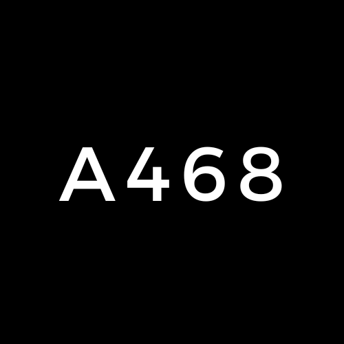

# A468 — Privacy Shield: Object Recognition & Anonymization

<div align="center">

<!--  -->

**A web-based tool that detects faces and license plates in images, then automatically blurs them for privacy protection.**

[](https://www.python.org/)
[](https://flask.palletsprojects.com/)
[](https://pytorch.org/)
[](LICENSE)

</div>

---

## Overview

A468 is a privacy-focused image processing web application. Upload any image, select which objects to detect, and the system will automatically locate and blur them — protecting identities and sensitive information.

Currently supported detection targets:
- **Faces** — detected using MTCNN + FaceNet (InceptionResNetV1 pretrained on VGGFace2)
- **License Plates** *(in development)* — detected using a custom InceptionResNetV2 model trained on annotated plate data

---

## Features

| Feature | Description |
|---|---|
| Face Detection & Blurring | Detects all faces in an image using MTCNN and applies elliptical Gaussian blur |
| License Plate Blurring | Detects and blurs number plates using a custom-trained TF/Keras model *(WIP)* |
| User Authentication | Register/login system with bcrypt-hashed passwords stored in SQLite |
| Image History | Per-user gallery of all previously processed images with timestamps and applied filters |
| GPU Acceleration | Automatically uses CUDA if available, falls back to CPU |

---

## Tech Stack

| Layer | Technology |
|---|---|
| Backend | Python, Flask |
| ML — Face Detection | PyTorch, `facenet-pytorch` (MTCNN + InceptionResNetV1) |
| ML — Plate Detection | TensorFlow/Keras, InceptionResNetV2 |
| Image Processing | OpenCV, NumPy, Pillow |
| Database | SQLite (via Python `sqlite3`) |
| Auth | `bcrypt` |
| Frontend | HTML, CSS (Jinja2 templates) |

---

## Project Structure

```
A468/
├── main.py                  # Flask app — routes, auth, upload, view
├── mtcnn.py                 # FaceModel class — MTCNN detection + blur logic
├── facecnn.py               # Standalone CNN trained on CIFAR-10 (experimental)
├── numplate_model.py        # NumplateModel class — plate detection + blur logic
├── numplate-model.py        # Alternate plate model script
├── numplate-train.py        # Training script for the license plate model
├── requirements.txt         # Python dependencies
├── static/
│   ├── A468.png             # Logo (full)
│   ├── A468_flat.png        # Logo (flat)
│   ├── style.css            # Main stylesheet
│   ├── style_new.css        # Updated stylesheet
│   └── img/                 # Sample/test images
└── templates/
    ├── landing.html         # Public landing page
    ├── login.html           # Login page
    ├── register.html        # Registration page
    ├── main.html            # Upload & result page (authenticated)
    └── view.html            # Image history gallery
```

---

## Installation

### Prerequisites

- Python 3.8+
- pip
- *(Optional)* NVIDIA GPU with CUDA for faster inference

### Steps

1. **Clone the repository**

   ```bash
   git clone https://github.com/XynoxTheDev/A468.git
   cd A468
   ```

2. **Create and activate a virtual environment** *(recommended)*

   ```bash
   python -m venv venv
   source venv/bin/activate        # Linux/macOS
   venv\Scripts\activate           # Windows
   ```

3. **Install dependencies**

   ```bash
   pip install -r requirements.txt
   ```

   > **Note:** `torch`, `torchvision`, and NVIDIA CUDA packages are included in `requirements.txt`. If you are on CPU only, you can replace the CUDA torch packages with the CPU-only build from [pytorch.org](https://pytorch.org/get-started/locally/).

4. **Run the application**

   ```bash
   python main.py
   ```

5. Open your browser and navigate to `http://localhost:5000`

---

## Usage

### 1. Register / Log In
Create an account on the registration page. Passwords are hashed with bcrypt before storage.

### 2. Upload an Image
From the main dashboard, upload any image and select which filters to apply:
- Check **Face** to detect and blur all faces in the image.
- *(License plate blurring is in development)*

### 3. View Results
The processed image is displayed immediately and saved to your personal history.

### 4. Image History
Navigate to the **View** page to browse all images you have previously processed, along with timestamps and the filters that were applied.

---

## How It Works

### Face Detection & Blurring (`mtcnn.py`)

1. MTCNN detects all face bounding boxes in the image.
2. Each bounding box is expanded (2x) to include surrounding context.
3. A Gaussian blur (`kernel=99x99, sigma=15`) is applied to the face region.
4. An elliptical mask blends the blurred face naturally back into the original image.

### License Plate Detection (`numplate_model.py`)

1. The image is resized to `224x224` and normalized.
2. A fine-tuned InceptionResNetV2 model predicts bounding box coordinates.
3. Coordinates are denormalized back to original image dimensions.
4. The detected region is blurred using Gaussian blur and composited back.

### Training the Plate Model (`numplate-train.py`)

The number plate model was trained on a custom annotated dataset:
- XML annotations parsed to extract bounding box labels
- InceptionResNetV2 (ImageNet pretrained) used as the base
- Custom regression head: `Flatten → Dense(500) → Dense(250) → Dense(4, sigmoid)`
- Trained for 180 epochs with MSE loss and Adam optimizer
- Saved as `numplate_detection.h5`

---

## Configuration

| Setting | Location | Default |
|---|---|---|
| Flask secret key | `main.py:14` | `'a468'` |
| Database file | `main.py:26` | `database.db` (auto-created) |
| Server port | `main.py:148` | `5000` |
| Debug mode | `main.py:148` | `True` |

> **Production note:** Change the secret key and disable debug mode before deploying.

---

## License

This project is licensed under the **MIT License**. See [LICENSE](LICENSE) for details.

---

## Contributors

- [XynoxTheDev](https://github.com/XynoxTheDev)
- [Anurag3301](https://github.com/anurag3301)
